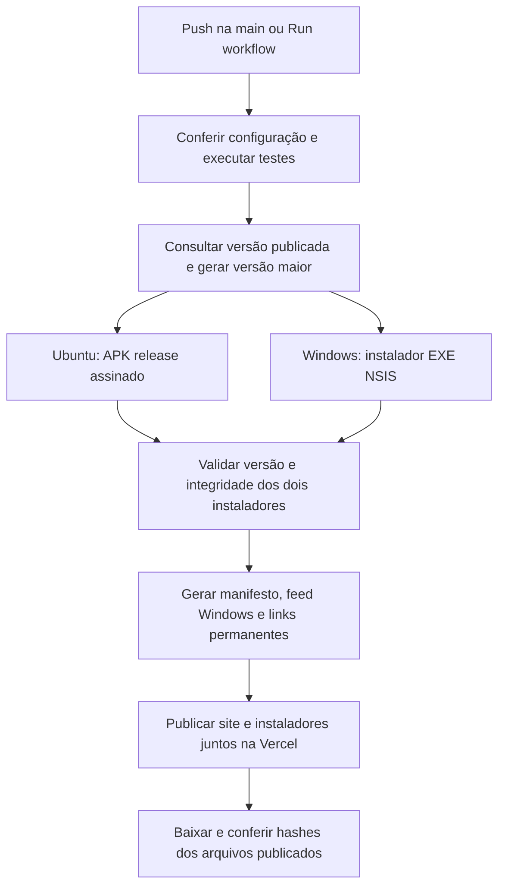

# Builds automáticos e links permanentes

O workflow pronto está em `.github/workflows/release.yml`. Ele usa o repositório **https://github.com/oluapk/backstage-music**. O endereço `https://github.com/users/oluapk/projects/1` é um quadro de planejamento do GitHub Projects; os arquivos do aplicativo e o workflow ficam no repositório.

O workflow foi preparado e validado localmente. A conexão GitHub desta sessão tem somente leitura; enviar os arquivos e cadastrar os secrets abaixo são a configuração inicial necessária para ativá-lo. Não há execução remota confirmada antes desses passos.

## O que acontece em cada push na main



Há uma execução de publicação por vez. O GitHub pode substituir execuções ainda pendentes pela mais recente; o resultado contém as alterações acumuladas da main. Antes de publicar, o workflow verifica se o commit ainda é o mais recente da branch. Se uma compilação falhar, o job de publicação não roda e a versão anterior continua disponível.

Editar um arquivo local sem fazer push não dispara o GitHub Actions. Para trabalhar apenas neste computador, use os scripts locais descritos abaixo. O pipeline publica commits na `main`; revisões/branches de trabalho não recebem as credenciais de publicação.

## 1. Configure os secrets no GitHub

Abra [Settings → Secrets and variables → Actions](https://github.com/oluapk/backstage-music/settings/secrets/actions), na aba **Secrets**, e cadastre:

| Secret | Valor |
| --- | --- |
| `VITE_SUPABASE_URL` | A mesma URL pública usada no `.env.local` |
| `VITE_SUPABASE_ANON_KEY` | A mesma chave pública `anon` ou publishable usada no app |
| `VERCEL_TOKEN` | Token da sua conta Vercel com acesso ao projeto Backstage Music |
| `ANDROID_KEYSTORE_BASE64` | O keystore que já assina seus APKs, convertido para Base64 |
| `ANDROID_KEYSTORE_PASSWORD` | Senha do keystore |
| `ANDROID_KEY_ALIAS` | Alias da chave Android |
| `ANDROID_KEY_PASSWORD` | Senha da chave Android |

O token Vercel pode ser criado nas configurações de conta da Vercel, em **Tokens**. Ele é usado pelo CLI no runner e não entra no bundle do aplicativo.

Na aba [Variables](https://github.com/oluapk/backstage-music/settings/variables/actions), cadastre:

| Variable | Valor deste projeto |
| --- | --- |
| `VERCEL_ORG_ID` | `team_FFBJyIBtMKFL6QsdINJRfohh` |
| `VERCEL_PROJECT_ID` | `prj_mumTLT1huueJ1wtCJ8p9tA1nYmyA` |
| `VITE_SUPABASE_STORAGE_BUCKET` | `music` |
| `VITE_SUPABASE_STORAGE_PUBLIC` | `false` para o bucket privado atual |

IDs também podem ser conferidos localmente em `.vercel/project.json`. A variável opcional `ANDROID_CERT_SHA256` permite definir o certificado esperado; o padrão já é o fingerprint do APK distribuído neste projeto.

### Preservar a atualização dos APKs já instalados

Os APKs anteriores usam a chave de depuração deste computador. Para o primeiro CI conseguir atualizar essas instalações, ele precisa usar essa mesma chave. O workflow gera um **APK release**, mas o certificado continuará sendo o fornecido no secret.

Para copiar o Base64 da chave atual ao clipboard, execute você mesmo no PowerShell:

```powershell
$backstageKey = Join-Path $env:USERPROFILE '.android\debug.keystore'
[Convert]::ToBase64String([IO.File]::ReadAllBytes($backstageKey)) | Set-Clipboard
```

Cole o clipboard no secret `ANDROID_KEYSTORE_BASE64`. Para esse keystore de depuração atual, os valores padrão são `androiddebugkey` para alias e `android` para as duas senhas. Se você já substituiu a chave, use os valores reais da chave que assina o APK instalado.

O fingerprint esperado do aplicativo já distribuído é:

```text
03065720a0d0e03e7fbd20d150f84cf96eff466f75f1a7198244673fde036465
```

O script `verify-apk.mjs` recusa um APK assinado com outra chave. Não gere uma chave diferente a cada runner: o Android rejeitaria a atualização. Para uma nova distribuição de produção, planeje a adoção de keystore próprio e guarde seu backup; trocar o certificado dos APKs atuais não é uma atualização comum. O instalador Windows continua sem certificado Authenticode, como a distribuição atual; assinatura de editor pode ser configurada em uma etapa posterior.

## 2. Envie o projeto ao repositório

Na configuração verificada, a pasta local ainda não tem um repositório Git e o repositório remoto está vazio. Instale o Git for Windows, se necessário, e reinicie o terminal do VS Code. Com os secrets já cadastrados, execute na raiz:

```powershell
git init -b main
git remote add origin https://github.com/oluapk/backstage-music.git
git add .
git commit -m "Configura builds automaticos Windows e Android"
git push -u origin main
```

Caso já exista um remoto/branch quando você executar estes passos, confira com `git remote -v` e `git status` antes de adicionar novamente. Se o Git solicitar identificação, configure seu nome e e-mail para os commits e autentique-se como uma conta com permissão de escrita nesse repositório.

`.gitignore` exclui `.env.local`, tokens, keystores, arquivos de build e os instaladores. Os binários são produzidos no CI; não são enviados ao Git. As definições de projeto Android e o Gradle Wrapper precisam entrar no commit. `.gitattributes` mantém o wrapper compatível com Linux.

## 3. Ative e acompanhe

Abra [Actions](https://github.com/oluapk/backstage-music/actions) e permita os workflows do repositório, caso o GitHub solicite. O primeiro push na `main` inicia **Build e publique Windows e Android**. Também é possível abrir esse workflow e escolher **Run workflow → main**.

Após a configuração inicial, para cada mudança:

```powershell
git add .
git commit -m "Descreve a alteracao do aplicativo"
git push
```

O pipeline usa Node 24, JDK 21, Android SDK/Build Tools 36 e runners Ubuntu/Windows. Os artefatos de cada execução ficam disponíveis no Actions por sete dias; os links públicos são hospedados pela Vercel, não pelos artefatos temporários do Actions.

Use este workflow como responsável pela publicação de produção. Se conectar o repositório à integração Git da Vercel, desative o deploy automático independente na produção: ele não deve publicar a interface antes de o Actions terminar os dois instaladores. A publicação configurada aqui usa `--prebuilt`, com os arquivos já validados.

## Links que permanecem iguais

- Android: **https://backstage-music.vercel.app/downloads/Backstage-Music-latest.apk**
- Windows: **https://backstage-music.vercel.app/downloads/Backstage-Music-Setup-latest.exe**
- Versão e hashes: **https://backstage-music.vercel.app/downloads/manifest.json**
- Feed do updater Windows: **https://backstage-music.vercel.app/downloads/latest.yml**

Os dois primeiros links respondem com redirect temporário **307** e `Cache-Control: no-store` para o arquivo da versão publicada, por exemplo `Backstage-Music-1.0.4.apk`. Isso evita duplicar os binários e impede cache permanente de uma versão antiga no link fixo. `prepare-vercel.mjs` gera as rotas a partir do manifesto; nenhuma URL precisa ser editada a cada release.

Os links com número identificam a compilação daquele deploy. O site mantém os arquivos da versão atual; para arquivo histórico de releases, guarde os artefatos em GitHub Releases ou bucket dedicado. O updater Windows continua consultando `latest.yml`, baixa em segundo plano e pede para reiniciar; o Android exige confirmar a instalação do novo APK.

## Versionamento automático

`prepare-release.mjs` consulta o manifesto publicado e compara sua versão com `package.json`. Ele escolhe uma versão estável maior que ambas, atualiza o lockfile e sincroniza `versionName`/`versionCode` do Android. O novo `versionCode` supera o código local e o publicado. O manifesto inclui esse código para a próxima execução.

O job de preparação calcula os números uma única vez e os transmite aos três runners. Assim, um checkout com `1.0.3` consegue produzir `1.0.10` se o site já estiver em `1.0.9`, sem exigir commit automático de versão e sem criar loop de CI. Falhas ao consultar a versão publicada interrompem o processo em vez de inventar um número que possa regredir.

## Scripts locais e regra para as próximas alterações

Depois de uma alteração de código, no PowerShell:

```powershell
npm.cmd run release:next
npm.cmd run deploy:release
```

O primeiro comando incrementa/sincroniza a versão, executa os testes, gera APK e EXE, verifica a assinatura Android, gera os downloads e prepara `.vercel/output`. O segundo publica os dois instaladores e a interface juntos, depois verifica arquivos, hashes e links fixos no domínio público.

Para conferir novamente uma publicação:

```powershell
npm.cmd run verify:release
```

No computador, o build Android padrão continua sendo `debug`, preservando a configuração já usada. Para testar localmente o mesmo APK release assinado do CI, configure `ANDROID_BUILD_TYPE=release`, `ANDROID_KEYSTORE_PATH`, `ANDROID_KEYSTORE_PASSWORD`, `ANDROID_KEY_ALIAS` e `ANDROID_KEY_PASSWORD` antes do comando. O arquivo da chave fica fora do repositório.

`npm run release:local` continua disponível como operação de baixo nível que compila a versão já definida. Para uma nova distribuição, prefira `release:next`, que também trata o incremento. `npm run build` segue sendo somente Vite; `build:web` inclui os downloads após as compilações nativas para não colocar um APK/EXE dentro de outro.

A regra de entrega foi registrada em `AGENTS.md`: futuras alterações de código devem gerar os dois instaladores e terminar a resposta com os links verificados e os comandos necessários. Se um build/publicação falhar, a resposta deve identificar o impedimento sem afirmar que os downloads estão atualizados.

Referências oficiais: [armazenamento de artefatos no Actions](https://docs.github.com/en/actions/using-workflows/storing-workflow-data-as-artifacts), [publicar no Vercel pelo Actions](https://vercel.com/kb/guide/how-can-i-use-github-actions-with-vercel) e [configuração do Build Output](https://vercel.com/docs/build-output-api/configuration).
