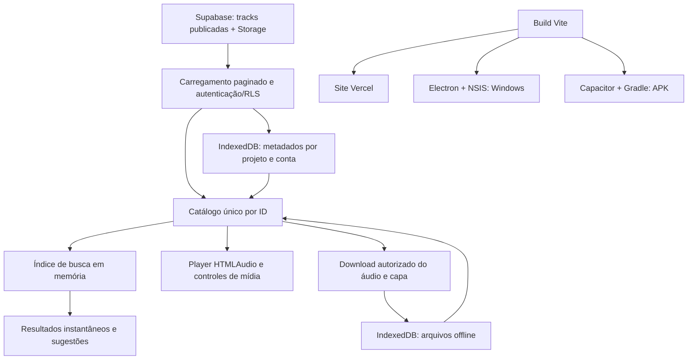

# Catálogo, busca e distribuição do Backstage Music

O fluxo atual de versionamento, GitHub Actions e links permanentes está no [guia de build automático](BUILD-AUTOMATICO.md). Para novas distribuições locais, use `npm.cmd run release:next` e `npm.cmd run deploy:release`; o fluxo manual abaixo detalha as etapas individuais.

O código está implementado no projeto. A versão 1.0.2 compartilha a interface React entre Vercel, Electron/Windows e Capacitor/Android. As músicas continuam sendo administradas no Supabase. Não há importação de arquivos pelo usuário, anúncios, cobrança ou controle de outro aparelho.

## Arquitetura



### Catálogo único e reprodução

- `src/catalog.js`: consulta somente `tracks` com `is_published=true`; pagina em lotes de mil, mantém ordenação estável e deduplica pelo ID. Se `duration_seconds`, `cover_path` ou `content_type` estiverem ausentes, tenta novamente sem a coluna. Erros de autenticação/RLS continuam visíveis.
- `src/App.jsx`: `catalogTracks` combina os registros do Supabase com os downloads pelo mesmo ID `supabase-<id>`. Um download substitui a fonte de áudio daquela faixa; não cria outra música. Favoritos, playlists e sugestões são referências ao catálogo.
- `src/TrackPlayButton.jsx` e `src/catalog-play.css`: o número vira Play no hover/foco; a faixa em reprodução mostra barras animadas e oferece Pausar no hover/foco. Em telas de toque o Play fica visível. A animação respeita `prefers-reduced-motion`.

Exemplo do componente usado nas listas:

```jsx
<TrackPlayButton
  title={song.title}
  number={index + 1}
  active={currentId === song.id}
  playing={playing}
  onClick={() => currentId === song.id ? togglePlayback() : playSong(song)}
/>
```

### Indexação e persistência

`src/catalog-cache.js` mantém o banco IndexedDB `backstage-music-library`, versão 3, com duas stores:

| Store | Conteúdo | Uso |
| --- | --- | --- |
| `catalog-snapshots` | Metadados de faixas, identificados por URL do projeto + usuário | Restaurar catálogo e pesquisar antes da resposta da rede |
| `offline-tracks` | Áudio e capa em Blob, com ID do catálogo | Ouvir faixas baixadas sem rede |

URLs assinadas e tokens não entram no snapshot. Ao abrir o app autenticado, o snapshot é restaurado e depois revalidado no Supabase. A atualização bem-sucedida substitui o snapshot, inclusive quando o catálogo fica vazio. Sem sessão, somente downloads já salvos ficam disponíveis. Metadados em cache não concedem acesso a áudio privado: para tocar sem conexão é necessário ter baixado a faixa.

No navegador, no Electron e na WebView Android, a persistência usa IndexedDB; não é um banco SQLite nem uma exportação para a pasta Música. O app solicita armazenamento persistente ao baixar, quando suportado. Limpar os dados do site/app ou desinstalar pode apagar downloads e preferências; o sistema também pode limitar o espaço.

`src/search.js` normaliza caixa e acentos uma vez ao criar o índice. Um índice invertido de trigramas reduz os candidatos para buscas com três ou mais caracteres; termos curtos consultam o texto já normalizado. A verificação final exige todos os termos, mesmo fora de ordem. Sugestões de faixas, artistas, álbuns e playlists vêm da base interna.

```js
const index = createSearchIndex(makeSearchEntries(catalogTracks, playlists));
const suggestions = getSearchSuggestions('coracao joao', index, 10);
```

O React reutiliza o índice até o catálogo ou as playlists mudarem. A busca não faz requisições a cada tecla. Listas de faixas exibem cem registros por vez, com a opção de mostrar mais. Para catálogos muito maiores, o próximo passo é um Web Worker para construir o índice sem ocupar a thread da interface.

## Preparar o ambiente

Use Node.js compatível com Capacitor 8, JDK 21 e Android Studio com SDK 36. No PowerShell da raiz:

```powershell
npm.cmd install
npm.cmd test
npm.cmd run dev
```

Configure `.env.local` com `VITE_SUPABASE_URL`, `VITE_SUPABASE_ANON_KEY`, `VITE_SUPABASE_STORAGE_BUCKET=music` e `VITE_SUPABASE_STORAGE_PUBLIC=false` para bucket privado. Use somente chave pública; mantenha RLS e políticas de Storage para usuários autorizados. As variáveis são incorporadas ao bundle, portanto precisam existir antes de compilar todas as plataformas.

As colunas obrigatórias são `id`, `title`, `artist`, `album`, `object_path`, `license`, `is_published` e `created_at`. Metadados opcionais: `cover_path`, `duration_seconds` e `content_type`. Para conteúdo de longa duração, há uma migração opcional em `supabase/catalog-content.sql`; ela não foi executada automaticamente. Sem essa coluna o conteúdo é tratado como música.

## Gerar o APK Android

O script detecta o SDK em `ANDROID_HOME`, `ANDROID_SDK_ROOT` ou `%LOCALAPPDATA%\Android\Sdk`. Se necessário, configure nesta sessão do terminal, usando o caminho instalado no seu computador:

```powershell
$env:JAVA_HOME = 'C:\Program Files\Eclipse Adoptium\jdk-21.0.12.101-hotspot'
$env:ANDROID_HOME = "$env:LOCALAPPDATA\Android\Sdk"
npm.cmd run build:apk
```

Esse comando executa o build Vite, `cap sync android` e `gradlew assembleDebug`. O APK sai em `android/app/build/outputs/apk/debug/app-debug.apk`. No celular, abra o arquivo e autorize a instalação pelo navegador/gerenciador usado. Com depuração USB, também é possível executar:

```powershell
& "$env:ANDROID_HOME\platform-tools\adb.exe" install -r .\android\app\build\outputs\apk\debug\app-debug.apk
```

O APK gerado por esse comando é de depuração, instalável diretamente. Para distribuir uma versão de produção, abra `npm.cmd run android:open` e use **Build → Generate Signed Bundle / APK → APK**. Crie e guarde um keystore de produção e seus backups; futuras atualizações precisam usar a mesma chave. Para Play Store, gere AAB assinado. Não troque a assinatura de uma instalação existente esperando que o Android aceite uma atualização por cima.

## Gerar o instalador Windows

```powershell
npm.cmd run dist:win
```

O Electron Builder empacota o build local e gera em `artifacts/windows/`:

```text
Backstage-Music-Setup-1.0.2.exe
Backstage-Music-Setup-1.0.2.exe.blockmap
latest.yml
```

O EXE é um instalador NSIS. A build atual não usa certificado Authenticode, portanto o Windows pode mostrar aviso de editor desconhecido. Para distribuição pública, configure assinatura com certificado Windows no pipeline de build e mantenha a identidade do aplicativo e do editor. Não distribua o diretório `win-unpacked` como substituto do instalador.

## Downloads reais no botão Instalar Aplicativo

O botão consulta `/downloads/manifest.json` e apresenta links para os dois arquivos da versão. O manifesto é gerado a partir dos arquivos reais com tamanho e SHA-256, sem URLs arbitrárias. Não é necessário escrever esse JSON manualmente.

Para gerar tudo na ordem correta:

```powershell
npm.cmd run release:local
```

Equivale a:

```powershell
npm.cmd run build:apk
npm.cmd run dist:win
npm.cmd run stage:installers
npm.cmd run build:web
```

`stage:installers` verifica a versão do APK, copia os dois instaladores e os metadados de atualização para `installers/` e gera `manifest.json`. `build:web` compila a interface e copia esses downloads verificados para `dist/downloads/`. A configuração da Vercel usa `build:web`; o upload precisa incluir `installers/`.

As compilações nativas usam `build`, que não inclui instaladores no bundle. Isso evita colocar um APK/EXE dentro de outro APK/EXE. Não mude `build` para copiar downloads.

Para publicar manualmente na Vercel, depois de gerar e revisar os arquivos:

```powershell
npx.cmd vercel --prod
```

Os binários não entram no Git. Um deploy automático por Git precisa de um pipeline que gere/baixe os artefatos para `installers/` antes do build web. Não basta versionar o manifesto sem seus arquivos.

## Atualização contínua do Windows

Foi implementado `electron-updater` com feed HTTPS genérico em `https://backstage-music.vercel.app/downloads/`. O Electron Builder grava essa URL em `resources/app-update.yml`; não há token administrativo no aplicativo.

No processo principal (`electron/main.cjs`):

```js
const { autoUpdater } = require('electron-updater');
autoUpdater.autoDownload = true;
autoUpdater.autoInstallOnAppQuit = false;
// O projeto registra os eventos e chama checkForUpdates na abertura e a cada 6 h.
```

Quando uma versão maior é publicada, o app baixa o instalador, informa o progresso e pede para reiniciar quando estiver pronto. A instalação começa depois da escolha do usuário, preservando a sessão de escuta até esse momento. Também há **Ajuda → Verificar atualizações**, e o diálogo de instalação acessível pelo perfil mostra o estado no desktop. O preload expõe somente operações de atualização, com validação de origem no processo principal e isolamento de contexto.

Para cada próxima versão:

1. Aplique e teste as alterações.
2. Execute `npm.cmd version patch --no-git-tag-version` para atualizar `package.json` e lockfile.
3. Em `android/app/build.gradle`, atualize `versionName` para o mesmo número e incremente `versionCode`.
4. Execute `npm.cmd run release:local`.
5. Publique os arquivos gerados junto com o site. Mantenha EXE, blockmap e `latest.yml` da mesma build. No deploy Vercel eles entram juntos; em um bucket, envie binários antes do `latest.yml`.
6. Confirme que `/downloads/latest.yml`, o EXE e o APK retornam arquivos reais, sem redirecionamento para HTML/login.
7. Valide a atualização de uma instalação antiga para a nova numa máquina de teste antes de distribuir amplamente.

O `.exe` não muda apenas porque o código foi alterado: é preciso incrementar a versão, compilar e publicar. Instalações anteriores sem updater precisam receber este instalador uma vez. Android mantém o processo de atualização por APK com versão maior e mesma assinatura; não instala silenciosamente. O site recebe a nova versão ao recarregar após o deploy.

Para automatizar depois, use CI em runner Windows para gerar/testar os artefatos, preservando as chaves Android/Windows em secrets, e publicar após aprovação de release. O feed genérico pode apontar para armazenamento público de instaladores, como bucket separado no Supabase/S3; mantenha as músicas no bucket privado. GitHub Releases também é suportado, mas exige configurar `owner`/`repo` e o provedor de publicação; não embuta um token privado no app. Ao trocar o feed, publique uma versão de transição no endereço antigo para atualizar instalações já distribuídas.

## Resolver erros no terminal

| Mensagem | Correção |
| --- | --- |
| `installers/manifest.json` não existe | Execute `npm.cmd run release:local`; o manifesto é gerado depois dos instaladores. |
| APK precisa ser recompilado | Alinhe `versionName` com `package.json`, incremente `versionCode` e execute `npm.cmd run build:apk`. |
| Instalador Windows ausente | Execute `npm.cmd run dist:win`; não renomeie só o arquivo antigo. |
| Tamanho/hash não confere | Gere novamente a build e execute `stage:installers`; não edite os hashes manualmente. |
| `npm.ps1` bloqueado | Use `npm.cmd` e `npx.cmd` no PowerShell. |
| Java/SDK não encontrado | Instale os requisitos e confira `JAVA_HOME`/`ANDROID_HOME`. |
| `column tracks.duration_seconds does not exist` | A versão atual tem fallback; recompile/republique se ainda estiver usando uma versão antiga. |

`npm.cmd run build` compila somente a interface e funciona sem instaladores. `npm.cmd run build:web` exige os downloads preparados, por isso pode falhar mesmo depois de o Vite compilar com sucesso.

## Verificação

`npm.cmd test` cobre busca sem acentos, termos fora de ordem, catálogo de vinte mil faixas, paginação e erros de schema/permissão. `node scripts/check-interface.mjs` usa Edge instalado e dados fictícios para verificar reprodução, animação, downloads sem duplicação, persistência após reinício, links de instalação e telas de 320 a 1440 px. Não altera o Supabase real. Capturas ficam em `artifacts/functional-review/`.

Referências oficiais: [auto-update do Electron Builder](https://www.electron.build/v26/docs/features/auto-update/), [publicação do Electron](https://www.electronjs.org/docs/latest/tutorial/tutorial-publishing-updating) e [sincronização do Capacitor](https://capacitorjs.com/docs/getting-started).
